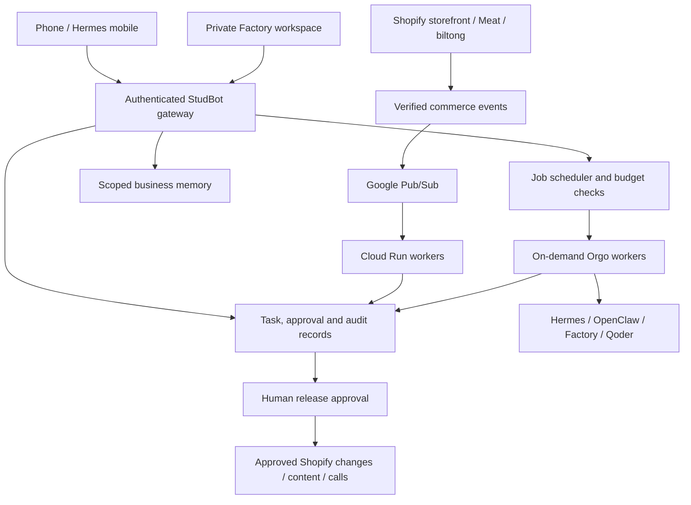

# StudBot integration — proposed deployment architecture

12 November 2026. Implementation in this branch is a local interface and read-only readiness adapter, not the full connected system.

## Existing work first

Portable Agents supplies an editorial console and fleet schemas; platform directories are not a live backend. Linux StudEx supplies Express APIs, but lacks access control and exposes execution routes. Its seeded health values are not VM telemetry. Hermes Command is the application shell selected for this isolated branch. The current branch does not enable the insecure Linux execution APIs.

The pre-existing Coffee Pub/Sub design is relevant source material, not proof of provisioned Google resources. Reuse its event-driven approach without duplicating Shopify's order/payment authority. Keep the Sentinel Notion Projects queue canonical and attach stable project IDs to records.

## Google Cloud boundaries

Start with a few deployable services: authenticated workspace API, commerce-event intake, and worker dispatcher. Use durable state for task leases, approval versions, idempotency keys and job receipts. Use Cloud Storage for generated artifacts and a secrets service for provider credentials. Do not use container memory or ephemeral disk as the only customer record.

Shopify can deliver to Google Pub/Sub directly. Alternatively use HTTPS intake with raw-body HMAC verification. Enforce shop/tenant binding, deduplicate deliveries, tolerate reordering and reconcile against Shopify. Pub/Sub delivery uses Google IAM rather than Shopify HTTPS HMAC. Separate tenant authorisation from transport verification.

Cloud Run request-driven services may scale to zero. Pub/Sub push can wake consumers. Put bounded batch work into jobs; don't assume a stopped VM or zero-instance background loop can wake itself. Keep voice sessions on a suitable streaming service for the call duration; cold-start tolerance needs testing.

Sources:
- https://shopify.dev/docs/apps/build/webhooks/verify-deliveries
- https://shopify.dev/docs/apps/build/webhooks/delivery-structure
- https://docs.cloud.google.com/run/docs/about-instance-autoscaling

## Connector boundaries

- Hermes on Samsung is a separate Termux installation from the Mac. Await Android version, architecture, Hermes version and actual tool error before changes. Chat working does not prove model tool calling.
- Tailscale network membership, service authentication and phone-control permissions are separate. Current Android client requires Android 8+: https://tailscale.com/docs/install/android
- Google Drive should use one approved client/project folder and minimum OAuth scopes. Never place credentials in the browser, Git or shared notes.
- Base44 connector read succeeded and an existing HermesBoot app was found. Its backend and app roles need inspection. Listing it here does not connect its agents to this app.
- Qoder is installed on the Mac; account/session and repository authorisation unverified. It supports remote/cloud workflows, but creating remote jobs or granting repository access is a separate action: https://docs.qoder.com/cli/cloud-mode
- Factory Remote Control runs on an existing computer and connects outbound through its relay. Registration is an access change; no registration performed: https://docs.factory.com/remote-control
- Twilio WhatsApp calling needs eligible sender/account setup and consumer calling permission for outbound calls. A messaging integration alone is insufficient. Human approval, purpose, budget, consent and call receipt must be recorded before dialing: https://www.twilio.com/docs/voice/whatsapp-business-calling

## OpenClaw migration

Inventory exact MacBook instance/version/state and the target VM. Confirm current jobs, backups, dependencies, model access and scoped secrets. Stage the new worker with scheduling/outbound effects disabled. Test a synthetic draft and failure recovery. Cut over exactly one scheduler/consumer only after acceptance. Preserve a rollback checkpoint. No MacBook service should be stopped merely because the VM boots.

## Tenant and authority requirements

Customer companies need isolated credentials, document permissions, storage prefixes and task ownership. User-facing connections must never proxy arbitrary URLs or shell execution. Agent-generated plans are data, not authority. Local preview has no authentication and must stay bound to loopback; no production exposure is authorised by this branch.
